 

## About

Informatics undergraduate at Universitas Gunadarma, Jakarta. I am building toward a career as a **Machine Learning Engineer**, with Data Scientist and AI Engineer as neighboring paths.

I like projects that go past the notebook: raw data, then a model, then something a person can actually use, such as a dashboard or an automated training pipeline.

- **Asah 2025** (Dicoding & Accenture): Machine Learning cohort, completed in January 2026 with a final grade of Very Good. Led a 3-person capstone team that was named Best Capstone Team out of hundreds of teams.
- **Asah 2026** (Dicoding x GoTo): currently in the Data Science learning path.
- Comfortable with the full loop: data collection, cleaning, modeling, evaluation, and deployment of small apps.
- Open to internships, junior roles, and collaboration on data and ML projects.

## Featured projects

| Project | What it does | Stack |
| --- | --- | --- |
| [**iNsight**](https://github.com/t-sofiachairani/iNsight) ([live demo](https://insight-frontend-two.vercel.app/)) | Team capstone. Segments 41,143 iPhone retail customers into 4 groups with RFM and K-Means, then uses a Gemini-based AI agent to write customer personas and marketing strategies, with a churn early-warning list. My part: data analysis and data science. | Python, scikit-learn, K-Means, React, Express, Supabase, Gemini |
| [**E-Commerce Data Analysis**](https://github.com/ArbazFerdiansah/Data_Analysis_E-Commerce) | Joins 6 tables of a Brazilian online marketplace (about 99,000 orders) and shows that late delivery drops the average review score from 4.29 to about 1.7. Includes RFM customer segments and an interactive dashboard. | Python, Pandas, Seaborn, Streamlit |
| [**Bike Sharing Analysis**](https://github.com/ArbazFerdiansah/Data_Analysis_Bike_Sharing) | Finds 3 hourly demand patterns (low, high, peak commute) in 17,379 hourly rental records with K-Means, and compares weekday and weekend use. | Python, Pandas, scikit-learn, Streamlit |
| [**Shopee Review Sentiment**](https://github.com/ArbazFerdiansah/Shopee-App-Sentiment-Analysis-NLP-) | Scrapes 184,500 app reviews, builds an Indonesian text-cleaning pipeline, and compares TF-IDF + Logistic Regression (85.9% test accuracy), linear SVM (85.1%), and a BiLSTM (82.0%). Explains why the simplest model generalizes best. | Python, Sastrawi, scikit-learn, TensorFlow |
| [**Intel Image Classification**](https://github.com/ArbazFerdiansah/Intel-Image-Classification-Computer-Vision-) | 4-block CNN for 6 scene classes, about 89% test accuracy, exported to TensorFlow Lite and TensorFlow.js. | Python, TensorFlow, Keras |

<!--
Add these three rows once you have confirmed the repository names, then delete this comment.
| [**Telco Churn MLOps Pipeline**](https://github.com/ArbazFerdiansah/REPO_NAME) | Random Forest churn model packaged as an MLflow Project, retrained automatically on every push through GitHub Actions. | Python, scikit-learn, MLflow, GitHub Actions |
-->

## Tech stack

## GitHub activity

  
  

## Building toward

- Deep learning with PyTorch, beyond the TensorFlow work I have done so far.
- Putting models behind an API and packaging them so others can run them.
- Experiment tracking and automated checks for ML projects, as a habit rather than a one-off.

Let's connect on [LinkedIn](https://www.linkedin.com/in/arbaz-ferdiansah-15198232b/).

<!--
**ArbazFerdiansah/ArbazFerdiansah** is a ✨ _special_ ✨ repository because its `README.md` (this file) appears on your GitHub profile.

Here are some ideas to get you started:

- 🔭 I’m currently working on ...
- 🌱 I’m currently learning ...
- 👯 I’m looking to collaborate on ...
- 🤔 I’m looking for help with ...
- 💬 Ask me about ...
- 📫 How to reach me: ...
- 😄 Pronouns: ...
- ⚡ Fun fact: ...
-->
